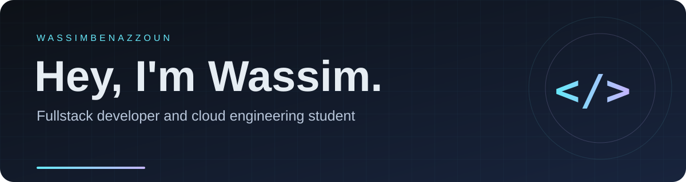
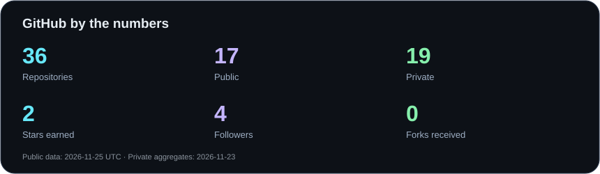
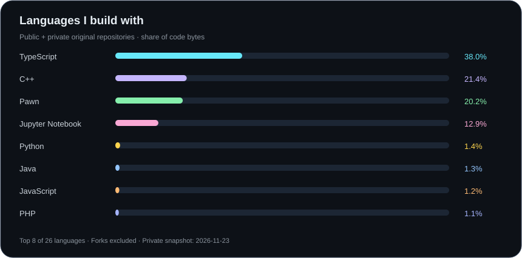

## About

I'm **Wassim**, a full-stack developer from **Tunisia**.

I work with **TypeScript, React, NestJS, and PostgreSQL** on web apps, mobile apps, and Discord bots.

## Tech stack

**Languages**

**Frameworks & tools**

## Projects

| Project | What it does | Focus |
| :--- | :--- | :--- |
| 📍 **[Vero](https://github.com/WassimBenAzzoun/vero)** | Tunisian shop reviews, built with Expo, NestJS, and PostgreSQL. | Mobile · APIs |
| 🎛️ **[Kickbot Dashboard](https://github.com/WassimBenAzzoun/kickbot-dashboard)** | Dashboard for Discord guild setup, tracked streamers, and notifications. | TypeScript · Dashboard |
| 🔔 **[Kickbot Backend](https://github.com/WassimBenAzzoun/kickbot-backend)** | Backend API and Discord bot services for Kick live notifications. | TypeScript · Bots |
| ☁️ **[Cloud Anomaly Detection](https://github.com/WassimBenAzzoun/anomaly-detection-cloud)** | A Python project exploring anomaly detection in the cloud. | Python · Cloud |

## GitHub stats

